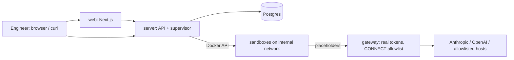

# Terrarium

> **For learning and demos.** Terrarium is built to run on one developer machine, and some
> trade-offs keep it simple to run there rather than safe to share: login is by user name only
> (no password, localhost only), sandboxes are Docker containers sharing the host kernel, the
> server controls Docker through its socket, and one Claude/ChatGPT subscription and one GitHub
> token serve every user. See the residual risks in `docs/threat-model.md` before running it
> anywhere else.

A single-machine prototype of an internal platform for remote coding-agent sessions. An engineer
starts Claude Code or Codex sessions in isolated, disposable Docker sandboxes, then monitors them,
sends follow-up prompts, attaches to the live stream and stops them, over an HTTP API, MCP or a
web UI. Sessions run on the engineer's Claude Max / ChatGPT Plus subscription, and the
real credentials never enter a sandbox.

- Requirements: `docs/initial-requirements/requirements.txt`
- Plan and architecture: `docs/plan/local-prototype-plan.md`
- Threat model (demonstrated vs design-only controls): `docs/threat-model.md`
- Contracts: `docs/contracts/` (API, sandboxd, gateway)
- Spikes that proved the credential swap: results in `docs/plan/local-prototype-plan.md` §5.2–5.3
  (the spike code was removed once `platform/internal/gateway` replaced it)



## What was built vs reused

| Built | Reused |
|---|---|
| Go control plane: API, reconcile-loop supervisor, Docker provider, harness adapters (`platform/internal/`) | Claude Code, Codex CLI, yq, jq in the sandbox image (pinned) |
| Credential-swapping gateway + CONNECT allowlist proxy (`platform/internal/gateway`) | Docker Engine, Postgres, Docker Compose |
| `sandboxd` in-sandbox exec daemon (`platform/cmd/sandboxd`) | Next.js, pgx, Go stdlib HTTP |
| Web UI (`web/`) | |

## Layout

| Path | Contents |
|---|---|
| `mise.toml` | Required tools (pinned) and every developer command: `mise tasks` |
| `platform/` | Go module: API server, gateway, sandboxd, credentials CLI (`cmd/`, `internal/`), runtime config (`config/`: presets, prices), sandbox image (`images/agent`) and a Go-only `Makefile` |
| `web/` | Next.js web UI |
| `deploy/` | `compose.yaml` and the control-plane `Dockerfile` |
| `docs/` | Contracts, plan, threat model, drills |

## Prerequisites

**Install yourself** (everything else comes from mise):

- macOS (credentials are kept in the macOS keychain)
- [Docker Desktop](https://www.docker.com/products/docker-desktop/), running
- [mise](https://mise.jdx.dev) (`brew install mise`)

Then, in the repository, let mise install the pinned tools: Go, Node, jq, yq, and Claude Code and
Codex at the same versions as the sandbox image:

```bash
mise trust && mise install
```

**Accounts.** Terrarium runs both Claude Code and Codex, but one of them is enough; configure only
what you have. GitHub is optional.

| Account | Enables | Without it |
|---|---|---|
| Claude subscription (Max) | Sessions with `"harness": "claude-code"` | Those sessions fail; Codex sessions still work |
| ChatGPT subscription (Plus or higher) | Sessions with `"harness": "codex"` | Those sessions fail; Claude Code sessions still work |
| GitHub (`gh` logged in, or a fine-grained token), optional | Agents pushing branches and opening PRs on your behalf; private repositories | Public repositories still clone; pushes and PRs are refused |

`mise run credentials` (next step) lets you pick just the accounts you have.

## Setup (once)

```bash
# Claude token and GitHub token -> macOS keychain; Codex login -> ~/.terrarium/codex
# (separate from ~/.codex). Pick the tools, then follow each login.
mise run credentials
```

## Run

```bash
mise run up    # builds images, applies migrations, starts postgres, server, gateway, web
mise run down  # stop (data is kept); `mise tasks` lists everything else
```

- Web UI: http://127.0.0.1:3000. Log in with a user name; a new name creates the user. The user
  menu (top right) copies your API token.
- API: http://127.0.0.1:8080 (`Authorization: Bearer <token>`), see `docs/contracts/api.md`.
  Interactive docs: http://127.0.0.1:8080/docs (also **API** in the web UI's top bar); spec at
  `/openapi.yaml`. A token is also returned by `curl -s -XPOST localhost:8080/login -d '{"name":"alice"}'`.
- Login has no password, so it only works on `localhost` (`TERRARIUM_LOGIN_ALLOWED_HOSTS`, a
  comma-separated list for the server). Never publish the ports on a public interface.

## Demo script (API)

```bash
T=$(curl -s -XPOST localhost:8080/login -d '{"name":"alice"}' | jq -r .token); H="Authorization: Bearer $T"
# start a session on a public repo
ID=$(curl -s -XPOST localhost:8080/sessions -H "$H" \
  -d '{"name":"explore hello world","harness":"claude-code","repo":"octocat/Hello-World","prompt":"What is this repo?"}' | jq -r .id)
# attach to the live stream (Ctrl-C to detach; reconnect any time with Last-Event-ID)
curl -N localhost:8080/sessions/$ID/events -H "$H" -H 'Accept: text/event-stream'
# follow-up, stop the running turn, inspect egress decisions, delete
curl -s -XPOST localhost:8080/sessions/$ID/turns -H "$H" -d '{"prompt":"Now try: curl https://example.com"}'
curl -s -XPOST localhost:8080/sessions/$ID/turns/current/stop -H "$H"
curl -s "localhost:8080/sessions/$ID/events?kind=egress" -H "$H" | jq '.events[].payload'
curl -s -XDELETE localhost:8080/sessions/$ID -H "$H"

# push and open a PR as you (needs GitHub in `mise run credentials`); in the session's repo the agent
# may update existing branches and create new ones named terrarium/<session-id>/*
curl -s -XPOST localhost:8080/sessions -H "$H" \
  -d '{"name":"readme fix","harness":"codex","repo":"<you>/<repo>","prompt":"Fix a typo in README.md, push and open a PR."}'
```

## Use it from another agent (MCP)

Terrarium is also an MCP server at `http://127.0.0.1:8080/mcp` with tools to list presets, create,
wait for, inspect, follow up and terminate sessions (`docs/contracts/mcp.md`). The web UI's **MCP**
page has copy-paste setup commands with your token filled in (shown masked, copied in full).

## Tests

```bash
mise run test  # starts postgres, runs go vet + go test (platform/) and web lint + typecheck
```

The Go suite covers the state machine and supervisor (crash and reattach, stop, TTL, idle timeout,
lost sandbox, orphan cleanup, advisory lock), the gateway (token swap, route allowlist, budget,
usage accounting, Codex refresh, CONNECT allowlist, GitHub repository/branch checks), sandboxd and the API (auth, ownership, limits,
SSE).

## Not in this prototype

IaC for a real deployment, Kubernetes, microVM isolation, per-engineer GitHub credentials (one
`gh` token for the deployment today), mid-turn steering. The threat model and plan describe how they fit.
