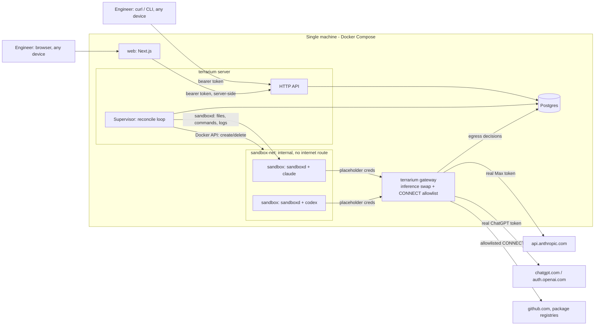
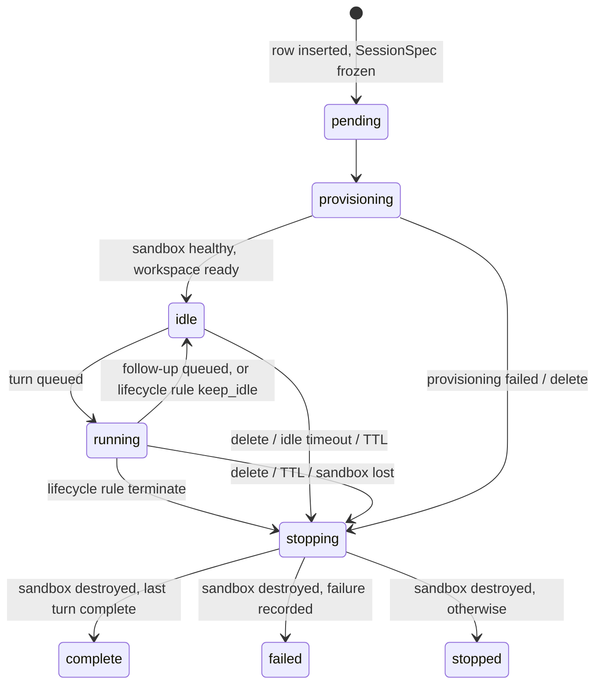

# Terrarium: local prototype plan

This plan replaces `docs/initial-design/02-terrarium-build-plan.md` for the current scope. It keeps
the principles of `01-reference-architecture-simplified.md` §9 and re-targets the build at the
requirements in `docs/initial-requirements/requirements.txt`: engineer-driven remote sessions with
Claude Code and Codex on subscription auth, on one machine.

## 0. Scope and decisions

**In scope:** one end-to-end slice on a single machine. Create and destroy an isolated, disposable
environment, run Claude Code or Codex in it, and let an engineer start, monitor, send follow-ups
to, attach to and stop several sessions over an HTTP API.

**Out of scope now:** Kubernetes/kind, Temporal, IaC for the real setup (deferred), MCP surface
(later, on top of the API), agent-created child runs, Slack/GitHub/Jira surfaces, memory, release
pipeline, Pi.

| # | Decision (2026-10-10) | Consequence |
|---|---|---|
| D1 | Docker Compose runs the local stack | The cloud setup is described in docs, not applied |
| D2 | Subscriptions only: Claude Max and ChatGPT Plus. No API keys | Spend is quota, not dollars. Credential handling differs per vendor (§5) |
| D3 | Gateway swaps placeholder credentials for real ones, for both harnesses | No real credential in any sandbox. Claude side carries a terms risk (§5.4). Both swaps need a spike (§9, S1/S2) |
| D4 | Postgres-backed reconcile loop instead of Temporal | Must keep a clean migration seam to Temporal (§4.4) |
| D5 | HTTP API is the control surface; MCP later wraps the same service layer | API handlers stay thin |
| D6 | Each turn is one harness process that resumes the harness session | Uniform across harnesses; idle sessions cost nothing; no mid-turn steering yet |
| D7 | Web UI is a Next.js app in `web/`, talking only to the HTTP API | UI holds no business logic; the API stays the single control surface |
| D8 | No IaC for now | Revisit after the slice works |

**Key difference from the reference platform:** it is an automation platform (preset-driven runs
from GitHub/Slack/schedules, park-and-reply interaction). Terrarium is session-first: an engineer
drives a long-lived, multi-turn session and can attach to it from any device.

---

## 1. Architecture



| Process | Networks | Holds secrets |
|---|---|---|
| `web` (Next.js) | default | Session cookie secret; engineer token only in an encrypted httpOnly cookie |
| `terrarium server` (API + supervisor) | default, `sandbox-net` | Engineer API tokens (hashed), gateway shared key |
| `terrarium gateway` | default, `sandbox-net` | Claude Max OAuth token, Codex `auth.json` |
| `postgres` | default | DB password |
| Sandboxes | `sandbox-net` only | Placeholders only |

One Go binary, subcommands `server`, `gateway`, `migrate`. `sandboxd` is a separate small binary
baked into the agent image.

### 1.1 Built vs reused

| Part | Choice | Why |
|---|---|---|
| Agents | Reused: Claude Code, Codex CLI (pinned versions) | Requirement |
| Sandbox runtime | Reused: Docker Engine API (`docker/docker/client`) | Already on the machine; one provider interface lets OpenSandbox/Kata replace it later |
| `sandboxd` (exec daemon) | Built, ~300 lines | Idempotent command IDs + offset-based log reattach are the core of crash recovery; OpenSandbox execd is heavier and adds a server |
| Supervisor | Built (reconcile loop) | D4 |
| Gateway | Built: Go `httputil.ReverseProxy` + CONNECT proxy | Vendor-specific token swap and Codex refresh handling don't exist off the shelf; CONNECT allowlist is ~100 lines |
| Store | Reused: Postgres 16, pgx, embedded SQL migrations | |
| Compose, Makefile | Reused tooling | D1 |
| Web UI | Built on Next.js (App Router, TypeScript) | D7 |

---

## 2. Domain model

### 2.1 Session and turn

- **Session**: one sandbox, one harness, one workspace, one owner. Lives across many turns until
  stopped, idle-timed-out or TTL-expired.
- **Turn**: one prompt → one harness invocation → one result. Turn 1 is the initial prompt; later
  turns are follow-ups.
- **SessionSpec**: frozen at creation (the reference platform's RunSpec): harness, harness version,
  image, repo, resources, network allowlist, limits, instructions, catalog digest. The supervisor
  only ever reads the SessionSpec.

### 2.2 Session state machine



Lifecycle rules (`spec.lifecycle`, preset defaults `on_complete: terminate`, `on_failure:
terminate`, `on_stop: keep_idle`; `keep_idle: true` on create keeps idle after every outcome) decide
what happens when a turn ends with nothing queued. See `docs/contracts/api.md` "Lifecycle".

Turn states: `queued → running → complete | failed | stopped | limit_exceeded`.

Follow-ups sent while a turn runs are queued and start when it finishes. Mid-turn steering (Claude
stream-json input) is a later extension.

### 2.3 Tables

```sql
CREATE TABLE sessions (
  id              uuid PRIMARY KEY,
  owner           text NOT NULL,
  status          text NOT NULL,
  harness         text NOT NULL CHECK (harness IN ('claude-code','codex')),
  spec            jsonb NOT NULL,              -- frozen SessionSpec
  harness_session text,                        -- claude session_id / codex thread_id, for resume
  container_id    text,                        -- cleanup obligation, written before create
  gateway_token   text NOT NULL UNIQUE,        -- per-session placeholder identity (hashed)
  tokens_used     bigint NOT NULL DEFAULT 0,
  idle_until      timestamptz,
  expires_at      timestamptz NOT NULL,
  created_at      timestamptz NOT NULL DEFAULT now(),
  ended_at        timestamptz
);

CREATE TABLE turns (
  session_id  uuid REFERENCES sessions(id),
  seq         int NOT NULL,
  prompt      text NOT NULL,
  status      text NOT NULL,
  command_id  text,                            -- sandboxd idempotency key, reattach
  log_offset  bigint NOT NULL DEFAULT 0,       -- reattach cursor
  usage       jsonb,                           -- input/output/cache tokens, num_turns
  result      text,
  error       text,
  started_at  timestamptz,
  ended_at    timestamptz,
  PRIMARY KEY (session_id, seq)
);

CREATE TABLE session_events (                  -- logs, lifecycle, egress decisions; feeds attach
  session_id uuid REFERENCES sessions(id),
  seq        bigint NOT NULL,
  kind       text NOT NULL,                    -- harness | lifecycle | egress | system
  turn_seq   int,
  payload    jsonb NOT NULL,
  ts         timestamptz NOT NULL DEFAULT now(),
  PRIMARY KEY (session_id, seq)
);
```

---

## 3. HTTP API

All endpoints need `Authorization: Bearer <engineer token>`. Tokens come from a local file
(`config/engineers.yaml`, hashed). A session is visible only to its owner.

| Method | Path | Purpose |
|---|---|---|
| `POST` | `/sessions` | `{harness, prompt, repo?, preset?}` → `202 {id, status}` |
| `GET` | `/sessions` | Owner's sessions: status, harness, repo, turns, tokens, age |
| `GET` | `/sessions/{id}` | Detail, current turn, limits, usage |
| `POST` | `/sessions/{id}/turns` | Follow-up prompt → `202 {seq}` (queued if a turn is running) |
| `GET` | `/sessions/{id}/events?after=N` | Paged events; `Accept: text/event-stream` for live attach |
| `POST` | `/sessions/{id}/turns/current/stop` | Stop the running turn; session stays |
| `DELETE` | `/sessions/{id}` | Stop the session and destroy the sandbox |
| `GET` | `/sessions/{id}/egress` | Allowed/denied egress decisions |
| `GET` | `/healthz` | |

"Attach" is the SSE stream of `session_events`, resumable with `Last-Event-ID`. An optional
`make shell ID=...` gives a `docker exec` shell for debugging; it is an operator tool, not part of
the engineer surface.

### 3.1 Web UI (`web/`)

A Next.js app (App Router, TypeScript) in its own folder with its own `package.json`. It is a
client of the HTTP API and nothing else: no database access, no Docker access.

- **Auth:** a login page takes the engineer's API token; a server action validates it against the
  API and stores it in an encrypted httpOnly cookie. Browser code never sees the token. All API
  calls go through Next.js route handlers / server components (backend-for-frontend).
- **Pages:**
  - `/sessions`: list with status, harness, repo, turns, tokens used, age; "New session" form
    (harness, repo, prompt).
  - `/sessions/[id]`: live event stream (SSE proxied by a route handler), turns with usage, a
    follow-up prompt box, "Stop turn" and "Delete session" buttons, and an egress panel showing
    denied requests.
- **Runs in Compose** as the `web` service; `npm run dev` on the host for development.

**Remote access:** the server and web UI bind to localhost. Access from another device goes through a private
overlay (e.g. Tailscale) to the host; the design doc covers this, the prototype demonstrates it if
time allows. Never publish the port on a public interface.

---

## 4. Supervisor

### 4.1 Idempotent operations

Every side effect is a function that takes the frozen spec and stable IDs and is safe to repeat.
These are the future Temporal activities.

| Operation | Idempotency key | Effect |
|---|---|---|
| `Provision(spec)` | container label `terrarium.session-id` | Find or create container, wait for `sandboxd /healthz`, upload bundle, clone repo |
| `StartTurn(spec, seq)` | `command_id = <session>-<seq>` in `turns` + sandboxd | Start harness command once |
| `TailTurn(spec, seq, offset)` | `log_offset` | Append events, parse usage, return new offset and exit state |
| `FinishTurn(spec, seq)` | conditional `UPDATE ... WHERE status='running'` | Read `/agent/turns/<seq>/result.json`, write terminal turn state |
| `StopTurn(spec, seq)` | – | `TERM`, then `KILL` after grace |
| `Cleanup(spec)` | container label | Delete container; no-op if gone |

### 4.2 Loop

A single goroutine runs at startup and every 5 s, plus on-demand wakeups from API writes:

1. **Orphans:** containers with a `terrarium.session-id` label whose session is terminal or
   unknown → `Cleanup`.
2. **Lost sandboxes:** sessions in `idle|running` with no container → `failed`, then `stopped`.
3. **Pending/provisioning** → `Provision`.
4. **Running turns** → ensure a tail goroutine exists (reattach from `log_offset` after restart).
5. **Queued turns on idle sessions** → `StartTurn`.
6. **Deadlines:** `now > expires_at` or `now > idle_until` → `stopping` → `Cleanup` → `stopped`.
7. **Limits:** `tokens_used` over budget → stop the turn with `limit_exceeded`.

Retries use exponential backoff stored on the row (`attempts`, `next_attempt_at`). Only one
supervisor runs; it takes a Postgres advisory lock at start so a second copy waits.

### 4.3 Invariants (from the reference design)

- The cleanup obligation (`container_id`, labels) is recorded before the container is created.
- At most one harness process per turn: stable `command_id`, idempotent in sandboxd.
- Exactly one terminal write per turn and per session: conditional updates.
- The result file is authoritative, not stdout or the exit code. The in-sandbox runner always
  writes one (EXIT trap writes `failed` if the harness did not).
- The SessionSpec is frozen; catalog changes affect only new sessions.

### 4.4 Temporal migration seam

| Now | With Temporal |
|---|---|
| §4.1 operations in `internal/ops` | Registered as activities unchanged |
| State transitions in `internal/session/machine.go` (pure function: state + event → state + ops) | Workflow code calls the same function |
| Reconcile loop drives ops | `SessionWorkflow` per session; follow-up / stop / delete become signals; deadlines become timers |
| Tail goroutine heartbeat (log offset) | Activity heartbeat details |
| Orphan sweep | Kept as a Temporal Schedule |

Rule: no package outside `internal/supervisor` knows that a loop drives the ops. Swapping the
driver touches only that package and its wiring.

---

## 5. Credentials and the gateway (D2, D3)

### 5.1 Principle

The sandbox is attacker-controlled. It holds only per-session placeholders. The gateway maps a
placeholder to a session, checks the session is `idle|running`, enforces its token budget, and
swaps in the real credential. Real credentials live only in the gateway container, loaded from the
host keychain or password manager at `make up`.

### 5.2 Claude Code (Max)

- Real credential: a token from `claude setup-token` (1-year, inference-only), stored in the
  host keychain.
- Sandbox env:
  - `CLAUDE_CODE_OAUTH_TOKEN=<per-session placeholder>`
  - `ANTHROPIC_BASE_URL=http://gateway:8080/anthropic`
  - `CLAUDE_CODE_DISABLE_NONESSENTIAL_TRAFFIC=1`
  - `ANTHROPIC_API_KEY`, `ANTHROPIC_AUTH_TOKEN` unset (they take precedence over the OAuth token).
- Gateway: forward only `POST /v1/messages` and `POST /v1/messages/count_tokens` (exact match, no
  encoded paths). The real token may carry more than inference scope, so no other
  `api.anthropic.com` path gets it. Look up the session by placeholder, replace `Authorization`,
  forward the `anthropic-beta` header unchanged (it carries `oauth-2025-04-20`), stream the
  response, add usage to `tokens_used`.
- Calls that bypass `ANTHROPIC_BASE_URL` with default settings: telemetry
  (`/api/event_logging/v2/batch`), bootstrap, MCP registry. All go away with
  `CLAUDE_CODE_DISABLE_NONESSENTIAL_TRAFFIC=1`; the CONNECT proxy denies them otherwise. Disable
  WebFetch with a managed-settings deny rule.
- **Spike S1 result (2026-10-10): works.** Placeholder accepted at startup, two-turn resume on the
  Max token, real token absent from sandbox env, filesystem and logs. See
  `spikes/s1-claude-swap/README.md`.

### 5.3 Codex (ChatGPT Plus)

- Real credential: `~/.codex/auth.json` from `codex login --device-auth`, mounted read-write into
  the gateway only. The gateway is the **only** refresher, which also removes the
  refresh-token-rotation conflict between parallel sessions.
- Sandbox `auth.json`: unsigned placeholder JWTs with the claims Codex parses locally (plan type,
  account id, far-future `exp`) plus a session claim. `cli_auth_credentials_store = "file"`.
- Sandbox `config.toml`: a custom provider (`requires_openai_auth = true`,
  `wire_api = "responses"`, `base_url = "http://gateway:8080/openai"`) instead of the built-in
  `openai` provider, which always tries WebSocket and adds a `/wham/accounts/check` preflight.
  `chatgpt_base_url` → gateway; analytics and OTel metrics off. `CODEX_REFRESH_TOKEN_URL_OVERRIDE`
  and `CODEX_REVOKE_TOKEN_URL_OVERRIDE` point at the gateway, which answers with placeholders.
- Gateway: forward only `POST /openai/responses` and `GET /openai/models` →
  `https://chatgpt.com/backend-api/codex/*`, swapping the bearer and `ChatGPT-Account-ID`.
  Deny all `chatgpt_base_url` routes (plugins, settings, accounts check, MCP); Codex works without
  them. Single-flight refresh against `auth.openai.com` with write-back; access tokens last ~10
  days.
- **Spike S2 result (2026-10-10): works.** Forged JWTs accepted, two-turn resume on the Plus login,
  real token absent from sandbox env, filesystem and logs. See `spikes/s2-codex-swap/README.md`.

### 5.4 Terms risk (documented, not hidden)

- Anthropic's terms say developers may not "collect, store, or intermediate Claude.ai credentials
  or session tokens". A gateway that holds and injects the Max token is close to that line, even
  for the token owner's own sessions. The prototype runs only the subscription owner's sessions,
  and the design doc states that a multi-engineer deployment needs either per-engineer
  subscriptions with each engineer's own token, or API/enterprise billing.
- OpenAI's terms forbid sharing an account; they don't address a token-injecting proxy, and
  OpenAI recommends API keys for automation.
- Fallback if a spike fails or the risk is unacceptable: token in the sandbox behind the same
  CONNECT allowlist (Claude), one Codex session at a time with `auth.json` in the sandbox (Codex).
  The threat model covers what that exposes.

### 5.5 Egress

- `sandbox-net` is a Compose network with `internal: true`: no route out.
- `HTTPS_PROXY=http://gateway:3128` with `Proxy-Authorization` carrying the session placeholder.
  CONNECT only to hosts in `spec.network.allow` (default: `github.com`, `codeload.github.com`,
  `registry.npmjs.org`, `pypi.org`, `files.pythonhosted.org`). No TLS interception.
- Every decision is written to `session_events` (`kind=egress`) and exposed at
  `/sessions/{id}/egress`.

---

## 6. Sandbox

### 6.1 Agent image

- `node:24-bookworm-slim` + git, curl, jq, ripgrep, Python. Pinned Claude Code 2.1.296 and Codex
  0.162.1 (see `docs/contracts/sandboxd.md`).
- Non-root user `agent` (uid 1000). `ENTRYPOINT ["sandboxd"]`; sandboxd reaps orphans when PID 1.
- Container options: `--cap-drop ALL`, `--security-opt no-new-privileges`, `--pids-limit`, CPU and
  memory limits, `--read-only` root with tmpfs `/tmp` and a per-session volume at `/home/agent`
  (workspace in `/home/agent/work`). No Docker socket, no host mounts.

### 6.2 sandboxd API

Same as `02-terrarium-build-plan.md` §2.6: `/healthz`, `PUT|GET /files`, `POST /commands`
(idempotent by `id`), `GET /commands/{id}`, `GET /commands/{id}/logs?offset=N`,
`POST /commands/{id}/signal`. Per-sandbox token in a header; reachable only on `sandbox-net`.

### 6.3 Harness adapters

Each turn is one process that exits; the session lives on in the harness's own session files in
the workspace. Idle sessions use no inference and no CPU.

| | Claude Code | Codex |
|---|---|---|
| Turn 1 | `claude -p "<prompt>" --output-format stream-json --verbose --permission-mode bypassPermissions --max-turns N` | `codex exec --json --dangerously-bypass-approvals-and-sandbox "<prompt>"` |
| Turn N | add `--resume <session_id>` | `codex exec resume <thread_id> --json ... "<prompt>"` |
| Session ID from | `system/init` event | `thread.started` event |
| Usage from | `result` event `usage`, `num_turns` | `turn.completed.usage` |
| Rate limit signal | `system/api_retry` with `rate_limit` | `turn.failed` / `error` |

Permission mode: both run with their own permission checks bypassed, because the container,
egress allowlist and credential swap are the boundary. Codex's bubblewrap sandbox cannot run in an
unprivileged container anyway. Claude keeps managed-settings deny rules (WebFetch, reading
`/agent/secrets*`) as defence in depth. The rationale goes into the threat model.

---

## 7. Runaway spend (quota, not dollars)

| Control | Where | Status |
|---|---|---|
| Per-turn agent step cap | Claude `--max-turns`; Codex via gateway request count per turn | Prototype |
| Per-session token budget | Gateway refuses inference once `tokens_used` exceeds `spec.limits.tokens` | Prototype |
| Session TTL and idle timeout | Supervisor deadlines | Prototype |
| Concurrent sessions per engineer | API admission check | Prototype |
| Quota exhaustion visibility | Rate-limit events surfaced as `session_events` | Prototype |
| Per-engineer weekly budget, alerts | Design only | |

`total_cost_usd` from Claude is a client-side estimate and not billing-relevant on Max; it is shown
as "API-equivalent cost", useful for comparing subscription vs API economics in the design doc.

---

## 8. Threat model (to write as `docs/threat-model.md`)

Each row lists controls the prototype demonstrates vs controls that exist only in the design.

| Threat | Demonstrated | Design only |
|---|---|---|
| Prompt injection (repo content, issue text, tool output) | Sandbox has nothing to steal; egress allowlist; budgets | Per-preset tool deny lists, output review |
| Credential theft | Placeholders only; real tokens in gateway; placeholder dies with the session | Hardware-backed secret store, rotation runbook |
| Exfiltration via allowed hosts (github.com push, gist, npm publish) | Allowlist, egress log | GitHub App token scoped to one repo, push only to `terrarium/*` branches; registry mirror read-only |
| Exfiltration via the model API | – | Documented residual risk |
| Untrusted dependencies | Container isolation, no host mounts | Internal mirror, lockfile-only installs |
| Insecure agent-written code | Agent cannot merge | PR-only output, required review and CI |
| Runaway spend | §7 | |
| Container escape | cap-drop, no-new-privileges, non-root | gVisor/Kata in the real setup |
| Compromised engineer token | Per-engineer tokens, session ownership | SSO/OIDC, short-lived tokens |

---

## 9. Milestones

Commit after each milestone. Each one ends with a check you can run.

| # | Milestone | Done when |
|---|---|---|
| S1 | **Spike: Claude placeholder swap.** Minimal Go reverse proxy + container with `CLAUDE_CODE_OAUTH_TOKEN=placeholder` | `claude -p "hi"` completes through the proxy; list every host it contacts |
| S2 | **Spike: Codex placeholder swap.** Forged unsigned JWTs + proxy | `codex exec --json "hi"` completes; refresh triggered by the proxy works; WebSocket path works |
| M0 | Skeleton: Go module, `server|gateway|migrate`, Compose (Postgres), Makefile | `make up && make migrate` succeed |
| M1 | Agent image + sandboxd, run by hand | `docker run` + `curl sandboxd` runs a turn of each harness and writes a result file |
| M2 | Store, API, auth, SessionSpec freeze | `POST /sessions` creates a row; another engineer's token gets 404 |
| M3 | Docker provider + supervisor loop: provision, turns, tail, cleanup | Session goes `pending → idle → running → idle`; `DELETE` removes the container |
| M4 | Follow-ups, stop, SSE attach, idle/TTL | Two parallel sessions (Claude + Codex), follow-up keeps context, attach from a second terminal, stop mid-turn |
| M5 | Gateway: inference swap for both + CONNECT allowlist + egress events | `env` in sandbox shows only placeholders; `curl https://example.com` denied and visible in `/egress`; agents still work |
| M6 | Limits: token budget, max turns, concurrency cap | A low-budget session ends its turn with `limit_exceeded` |
| M7 | Resilience drills and tests | Kill server mid-turn → reattach, no second harness; `docker kill` sandbox → session `failed` and cleaned; orphan container removed on start |
| M8 | Web UI (`web/`): login, sessions list, new session, session page with live events, follow-up, stop, egress panel | All M4 checks repeated from the browser on a second device |
| M9 | Docs: threat model, real-setup design (cloud mapping, network, identity), demo script | Demo script runs end to end |
| later | MCP server over the service layer; mid-turn steering; IaC for the real setup | |

Tests: unit tests for `session/machine.go` (table-driven transitions) and the gateway (swap,
budget, deny); integration tests with `testcontainers-go` for the Docker provider and sandboxd.

---

## 10. Open items

1. **IaC for the real setup:** deferred (D8). The requirements ask for IaC and best practices, so
   it has to come back before the interviews.
2. **Spike outcomes:** both swaps work (S1, S2); the §5.4 fallback is only needed if the terms
   risk is judged unacceptable.
3. **Repo access for private repos and PR output** (GitHub App with per-repo token through the
   gateway) is design-only until the core slice works.
