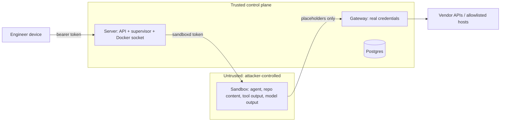

# Terrarium threat model

Scope: the local prototype (one machine, Docker Compose) and the design for a real deployment.
Every control is marked **Demonstrated** (built and verified in this repo, with the check that
proves it) or **Design** (described, not built). See `docs/plan/local-prototype-plan.md` for the
architecture.

## 1. Assets and trust boundaries

| Asset | Where it lives | Who must never get it |
|---|---|---|
| Claude Max OAuth token | Gateway container only (compose secret from the host keychain) | Sandboxes, logs, the database |
| Codex ChatGPT login (access + refresh token) | Gateway container only (`~/.terrarium/codex`, a login dedicated to the gateway) | Sandboxes, logs, the database |
| Engineer's GitHub token | Gateway container only (compose secret from the host keychain, `make credentials`) | Sandboxes, logs, the database |
| Session key (derives per-session gateway secrets) | Server container only (compose secret) | Sandboxes, gateway, database |
| Engineer API tokens | Engineer's device; server stores sha256 only; web UI keeps it in an encrypted httpOnly cookie | Browser JS, other engineers |
| Subscription quota | Upstream vendors | Runaway or hijacked agents |
| Engineer's code and repos | Sandbox workspace volume (deleted with the session) | Other sessions, the internet |

**Core assumption:** everything inside a sandbox is attacker-controlled. Task text, repository
content, dependency code, tool output and model output are data, never authority. A
prompt-injected agent is equivalent to an attacker with a shell as uid 1000 in the sandbox.

## 2. What a compromised agent can reach

| Target | Reachable? | Why |
|---|---|---|
| Internet (arbitrary host) | No | `terrarium-sandbox` is an `internal` Docker network: no route, no external DNS. Only the gateway is reachable |
| Allowlisted hosts (package registries) | Yes, port 443 only | CONNECT proxy with per-session allowlist from the frozen spec |
| GitHub | The session's repository only: fetch, push to `terrarium/<session-id>/*`, open a PR from such a branch | Gateway `/github/` route; GitHub is not on the CONNECT allowlist |
| Real Claude / Codex credentials | No | The sandbox holds placeholders derived from a per-session secret; the gateway swaps them |
| Inference on the engineer's subscription | Yes, until the session ends or its token budget is spent | The placeholder is a capability for the gateway; it dies with the session |
| Other sessions' sandboxes | Network yes, control no | Shared network; sandboxd requires a per-sandbox token that agents never see |
| Gateway account APIs (`/api/oauth/*`, `chatgpt.com/backend-api/*` other than inference) | No | Exact route allowlist |
| Server API | No | The server joins the sandbox network only to reach sandboxd; the API refuses every request from the pinned sandbox subnet (`403`, verified from a live sandbox) |
| Postgres, web UI, Docker socket | No | Not on the sandbox network |
| Host filesystem | No | No host mounts; read-only root; home is a per-session volume |

## 3. Threats and controls

### 3.1 Prompt injection

An instruction hidden in a repo, issue text or web content makes the agent act for an attacker.
The platform does not try to detect injection; it limits what an injected agent can do.

| Control | Status | Evidence |
|---|---|---|
| Nothing to steal in the sandbox (placeholders only) | Demonstrated | `docker export` of a live sandbox and `docker inspect`: 0 matches for the real token (spikes S1/S2 and the full stack) |
| Default-deny egress | Demonstrated | Agent asked to `curl https://example.com`: CONNECT `403`, recorded as egress event `denied`; with `--noproxy`: DNS fails |
| Egress decisions visible to the engineer | Demonstrated | `GET /sessions/{id}/events?kind=egress`, web UI Egress panel (verified in a headless browser against the real stack). Codex's routine auxiliary calls are denied without an event so real attempts stand out |
| Per-session token budget and step cap | Demonstrated (unit + integration tests) | Gateway `429` after budget; supervisor ends the turn `limit_exceeded`; Claude `--max-turns` |
| Agent cannot widen its own permissions | Demonstrated | Spec frozen at creation; gateway and supervisor read only the frozen spec |
| Tool-level deny rules (e.g. WebFetch) | Demonstrated | `/etc/claude-code/managed-settings.json` in the image |
| Output review: agent changes land only as PRs | Design | §3.4 |

### 3.2 Credential theft

| Vector | Control | Status |
|---|---|---|
| Read env / files in the sandbox | Placeholders only | Demonstrated |
| Use the placeholder elsewhere | Placeholder only works against the gateway, which is only reachable from the sandbox network, only while the session is live | Demonstrated (`403` for unknown/ended sessions in gateway tests) |
| Make the gateway call account endpoints with the real token | Exact method+path allowlist, encoded paths rejected | Demonstrated (spike S1 hardening, gateway tests) |
| Steal the sandboxd token to drive another sandbox | Token unset from sandboxd's env, `/proc/1/environ` unreadable, children don't inherit it | Demonstrated (sandboxd tests). Residual: visible to operators via `docker inspect` |
| Read real tokens from logs | Gateway logs header names only | Demonstrated (log grep: 0 matches) |
| Codex refresh-token rotation conflict / theft | Gateway is the only refresher of a dedicated login; Codex in the sandbox has fake refresh tokens answered by the gateway | Demonstrated in spike S2; refresh logic unit-tested |
| Steal engineer API token from the browser | httpOnly encrypted cookie; browser never sees the token | Demonstrated (UI e2e scanned all responses) |
| Compromise of the host or Docker socket | Server holds the Docker socket (root-equivalent) | Accepted locally. Design: replace with a sandbox runtime API (Kata/Firecracker) with scoped credentials |

### 3.3 Exfiltration

| Channel | Control | Status |
|---|---|---|
| Arbitrary HTTPS | Default deny | Demonstrated |
| DNS tunnelling | No external DNS on the internal network | Demonstrated (`getent hosts example.com` fails in the sandbox) |
| `git push` to an attacker repo, gist | GitHub only via the gateway route: the session's repository, `terrarium/<session-id>/*` branches, PR creation only | Demonstrated (live drill: push to `main` and fetch of another repo both `403`, recorded as egress events; gateway tests) |
| Pushed content on the session's own branch / PR | Visible to everyone who can read the repository; never merged automatically | **Residual risk.** A prompt-injected agent can publish workspace data to its branch or PR body |
| Allowed hosts: `npm publish` | Allowlist by host only today | **Residual risk.** Design: package registries through a read-only mirror |
| The model API itself (data in prompts) | Cannot be closed; inference is the product | Residual, documented. Data reaching the vendor is what the engineer already accepts by using the agent |
| Covert channels via request timing / sizes to allowed hosts | – | Out of scope |

### 3.4 Untrusted dependencies and insecure agent-written code

| Risk | Control | Status |
|---|---|---|
| `npm install` / `pip install` runs attacker code | It runs inside the same sandbox boundary: non-root, no capabilities, read-only root, no host mounts, egress allowlist | Demonstrated (container hardening checked with `docker inspect`) |
| Typosquatted or malicious package | Design: internal registry mirror with allowlisted packages, lockfile-only installs | Design |
| Container escape via kernel bug | Shared kernel locally | Design: gVisor or Kata/Firecracker microVM per sandbox in the real setup |
| Agent-written code with vulnerabilities or backdoors | The platform cannot merge anything; agents have no push credentials | Demonstrated (no git credentials exist). Design: PR-only output, branch protection, required review and CI, SAST on agent PRs |

### 3.5 Runaway spend (subscription quota)

On subscriptions the risk is exhausting the engineer's 5-hour / weekly quota (blocking their own
work), not a bill. `total_cost_usd` from Claude is an estimate, not billing.

| Control | Status |
|---|---|
| Token budget per session, enforced at the gateway (all inference passes through it) | Demonstrated |
| Max agent steps per turn (`--max-turns`) | Demonstrated |
| Session TTL and idle timeout, enforced by the supervisor | Demonstrated (supervisor tests) |
| Max active sessions per engineer (`429`) | Demonstrated |
| Per-turn usage visible in API and UI | Demonstrated |
| Vendor quota exhaustion surfaced, session stays usable | Demonstrated (live: ChatGPT Plus limit reached → turn `failed` with the vendor's message, session back to `idle`) |
| Per-engineer weekly budget, alerts | Design |

## 4. Permission modes

Both harnesses run with their own permission prompts disabled (`--permission-mode
bypassPermissions`, `--dangerously-bypass-approvals-and-sandbox`). Rationale: an unattended remote
session has nobody to approve prompts, and the in-tool sandboxes are weaker than the container
boundary (Codex's bubblewrap cannot even start in an unprivileged container). The container,
network and credential boundaries are the security controls; tool permissions are only defence in
depth (managed-settings deny rules). Claude Code refuses bypass mode as root, so the agent runs as
uid 1000.

## 5. Subscription and terms risk

- Anthropic's terms prohibit developers from "intermediating" Claude.ai credentials or session
  tokens. The gateway holds and injects the Max token, which is close to that line even though it
  serves only the subscription owner's own sessions. Mechanically it works (spike S1).
- OpenAI's terms forbid sharing an account and recommend API keys for automation; a
  token-injecting proxy is not addressed.
- **Consequence for a multi-engineer deployment:** each engineer must bring their own subscription
  login (the gateway then holds one credential per engineer), or the organisation uses API /
  enterprise billing. One shared subscription for many engineers is not acceptable.

## 6. Residual risks (accepted for the prototype)

1. Server holds the Docker socket (root-equivalent on the host).
2. Sandboxes share one network; isolation between them relies on the sandboxd token.
3. Docker containers share the host kernel.
4. Allowlisted hosts can receive exfiltrated data.
5. The gateway's Claude credential use sits close to Anthropic's terms (§5).
6. No TLS between components on the local machine; the web UI is plain HTTP on localhost (use
   `tailscale serve` for HTTPS from other devices).
7. The per-session home volume has no disk quota (Docker Desktop volumes do not support size
   limits); one agent can fill the Docker VM disk. Real setup: XFS project quotas or a sized
   block volume per sandbox.
8. The sandboxd token is visible to operators via `docker inspect` (not to agents).
9. The GitHub token is the engineer's `gh` OAuth token (`repo` scope on every repository they can
   reach). The gateway narrows use to one repository and branch prefix, but a gateway compromise
   exposes the full token. Real setup: a GitHub App user-to-server token per engineer.
